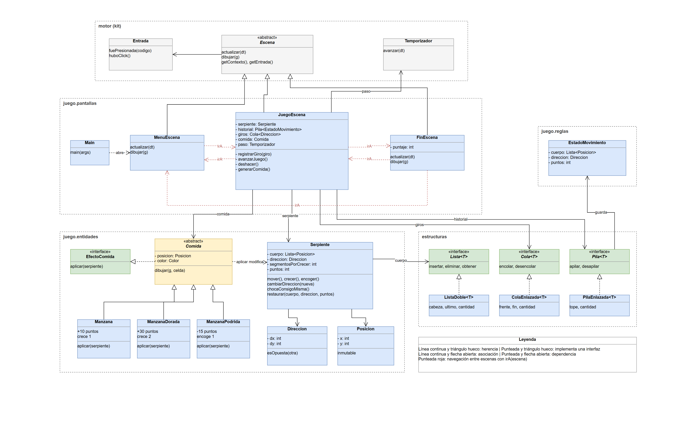

# Snake: Deshacer

Snake hecho en Java puro (Swing, sin librerías externas) para la Game Jam de
Programación II. Además de lo clásico —comer, crecer, no chocarse—, el juego
permite **deshacer** movimientos: cada paso se guarda en una pila y se puede
rebobinar.

**[▶ Jugar online](https://snake-deshacer.vercel.app)**

## Controles

| Tecla | Acción |
|---|---|
| Flechas | Mover la serpiente |
| `Z` | Deshacer el último paso |
| `P` | Pausa |
| `Enter` | Empezar / volver a jugar |
| `M` | Volver al menú (desde la pantalla final) |
| `Esc` | Salir |

## Estructura

| Paquete | Qué contiene |
|---|---|
| `motor` | El bucle del juego: ventana, escenas, entrada, temporizador y mundo |
| `juego/pantallas` | Las escenas del Snake (menú, juego, fin) y su `Main` |
| `juego/entidades` | Serpiente, manzanas (común, dorada, podrida), posición y dirección |
| `juego/reglas` | El estado que se guarda para poder deshacer |
| `estructuras` | Lista, pila y cola propias, enlazadas |
| `contratos` | Interfaces comunes: `Actualizable`, `Dibujable`, `Colisionable` |
| `fisica` | Cuerpos y materiales del motor |
| `ui` | HUD y texto en pantalla |
| `demo` | Escenas de ejemplo del motor |
| `verificador` | Pruebas de las estructuras de datos |
| `provisorio` | Implementaciones provisorias de las estructuras |

## Diagrama de clases



## Cómo correrlo

Requiere un JDK con `javac` y `java` en el PATH.

```sh
./compilar.sh
./ejecutar.sh juego.pantallas.Main
```

En Windows: `compilar.bat` y después `ejecutar.bat`.
